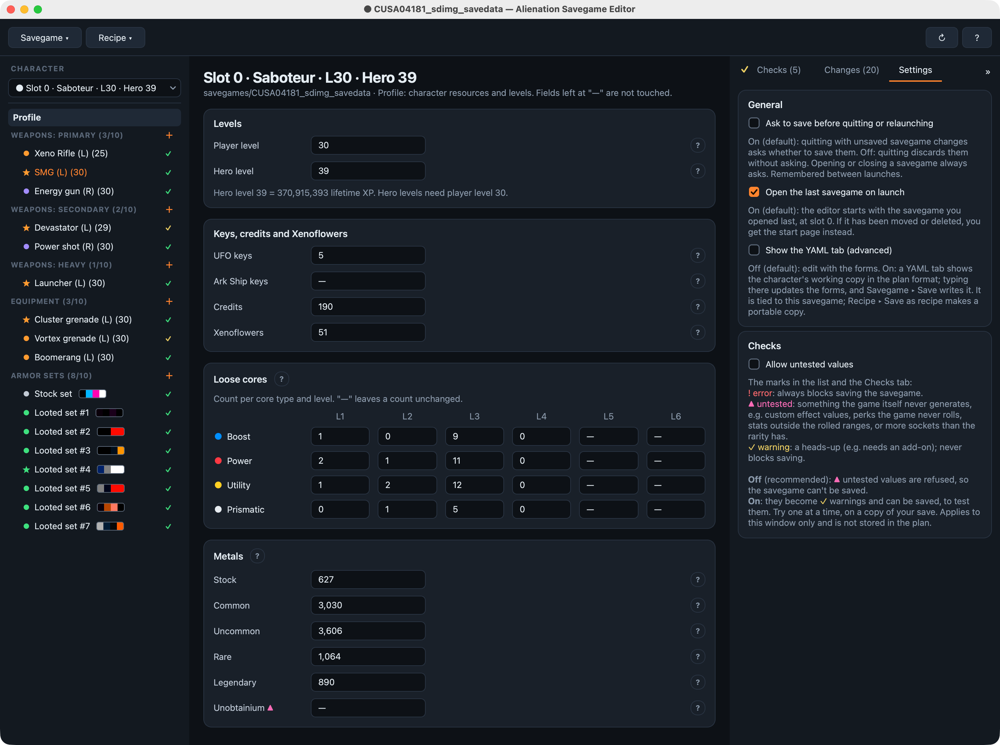
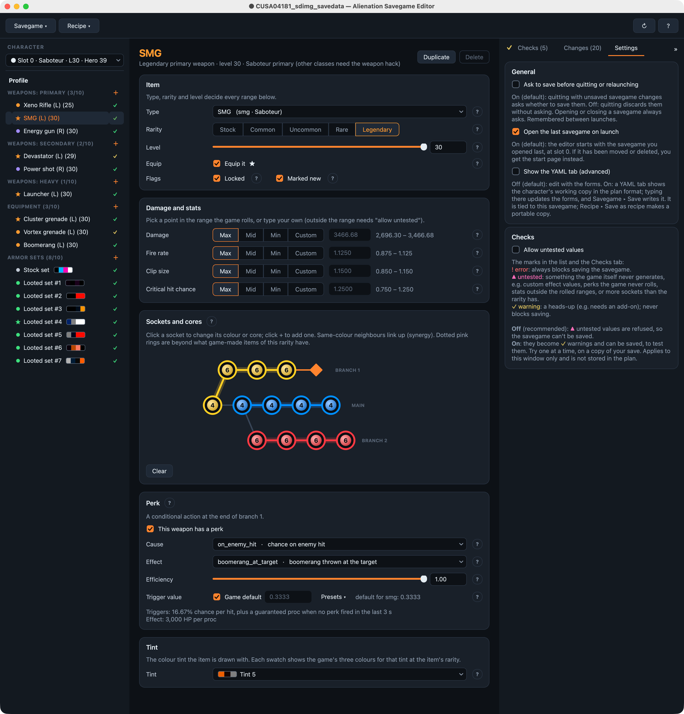
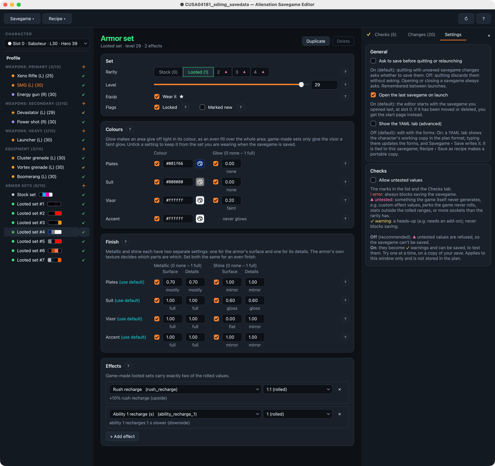

# Alienation (CUSA04181) save editor and patches

Tools and notes for Housemarque's PS4 game *ALIENATION* (CUSA04181, game update 01.07), from a dump of a purchased copy:

- **A savegame editor** (desktop app and command line) to add, replace and remove weapons, equipment and armor sets, and
  set resources and levels, using simple YAML recipes.
- **[ps-patch-system](https://github.com/illusionyy/ps-patch-system) patches** for the game: debug mode, 60 FPS,
  720p, skipping the intro videos, faster weapon scrapping.
- **Reverse-engineering notes** on the game's file formats, save layout, scripts and developer hooks.

**This repository contains no game files.** It includes none of the game's executable, data archives, art, audio,
video or text, and no savegames. The game dump and saves stay on the owner's machine and are excluded from the repo.
To use the editor you need your own savegame; to run the research scripts you need your own dump of the game. The
only game-derived content in the code is the facts the editor needs to read and write saves correctly: internal
item, perk and stat names, in-game item names, and a few number tables (weapon damage by level, XP per level, weapon
tint colours, perk strengths), all kept in one file, [`tools/lib/gamedata.py`](tools/lib/gamedata.py). The docs
describe how those facts were found. This is an unofficial fan project, intended for personal use with your own legally owned copy of the game. It is not affiliated with, endorsed by or connected to
Sony Interactive Entertainment, Housemarque or any other rights holder. *ALIENATION* and PlayStation are trademarks of
their respective owners.

## Provenance

This project was written by **Claude**, Anthropic's AI model, working in Claude Code (October 2026). That covers the
reverse engineering, the save editor and research code, the patches and all the documentation.

The project owner directed the work: they chose the goals and made the design decisions, supplied the game dump and
savegames from their own copy, and ran every console test. Results marked "works on console" are their test results.

## Screenshots

**Profile:** player and hero level, keys, credits, Xenoflowers, loose cores and metals.

**Weapon:** type, rarity and level, stats within the game's rolled ranges, sockets and cores, perk and tint.

**Armor set:** colours and glow per area, metallic and shine finish, and effects.

## Getting started

To edit a save, set up the Python environment and open the editor: see
[tools/README.md → Getting started](tools/README.md#getting-started). The full editor guide is
[docs/save-editor.md](docs/save-editor.md), and [tools/example-recipes/](tools/example-recipes/README.md) has
ready-to-use recipes.

You need your own decrypted savegame folder (`CUSA04181_sdimg_savedata`). The editor always writes an edited copy and
never overwrites the save it opened. Copy the result back to the console the same way you exported it.

To use the patches, copy [patches/xml_orbis/CUSA04181.xml](patches/xml_orbis/CUSA04181.xml) into your
ps-patch-system patch folder. Each entry's note in the file says what it does.

| Patch | Status |
|---|---|
| Enable debug mode | Works on console. The debug controls need a USB keyboard (key map in [docs/developer-hooks.md](docs/developer-hooks.md)). |
| 60 FPS | Works on console. The latest version (1.1, fixes for things that ran too fast) is untested. |
| Resolution 720p | Untested |
| Skip intro videos | Untested |
| Fast weapon scrapping | Untested |

Higher resolutions (1440p, 4K, supersampling) were tried and removed: they boot but crash once combat starts. The
analysis is in [docs/resolution.md](docs/resolution.md).

## Folders

| Folder | Contents |
|---|---|
| [`tools/`](tools/README.md) | The save editor, its example recipes, and the reverse-engineering scripts (`tools/research/`) |
| `docs/` | All findings, listed under [Docs](#docs) below |
| `patches/` | The ps-patch-system XML |
| `screenshots/` | Save editor screenshots used in this README |
| `recipes/` | Your own recipes. Not included in the repo |
| `dumps/` | The game dump (app0 + patch0). Not included in the repo; only the research scripts need it |
| `savegames/` | Original save exports. Not included in the repo. Treated as read-only |
| `edits/` | Edited saves written by the editor. Not included in the repo |

## Docs

Address and offset conventions are at the top of [file-formats.md](docs/file-formats.md#conventions-used-in-these-docs).

| Doc | Contents |
|---|---|
| [save-editor.md](docs/save-editor.md) | Save editor guide: recipe (YAML) format, every field, checks, examples |
| [file-formats.md](docs/file-formats.md) | Conventions, engine overview, `stream.dat` container, `STAD` compiled scripts, `savedata.dat` |
| [weapons-and-cores.md](docs/weapons-and-cores.md) | Weapons, perks, cores and tints: data model, save layout, safe bounds, item levels |
| [armor.md](docs/armor.md) | Armor colour sets: colour areas, glow, metallic/shine, effects; console test results |
| [developer-hooks.md](docs/developer-hooks.md) | Entitlement "key" gates, debug mode patch, debug menus and keyboard key map, tweakables |
| [cheat-codes.md](docs/cheat-codes.md) | Hidden menu cheat inputs, their gates, and the `AN.Menu.Data` cheat messages |
| [framerate.md](docs/framerate.md) | 60 FPS patch: how frame timing works, what was patched, console results |
| [resolution.md](docs/resolution.md) | Resolution patches: render setup, memory pools, why higher resolutions were removed |
| [intro-videos.md](docs/intro-videos.md) | Skip intro videos patch |
| [platform-windows.md](docs/platform-windows.md) | Why forcing the game's Windows mode breaks it (no patch shipped) |
| [ark-missions.md](docs/ark-missions.md) | Ark Ship (dreadnought) missions: how they unlock, playing them offline |

## License

The code and docs are under the [MIT License](LICENSE). The game-derived data in `tools/lib/gamedata.py` and the
game's names and trademarks are not covered: they belong to their owners (see the end of [LICENSE](LICENSE)).
